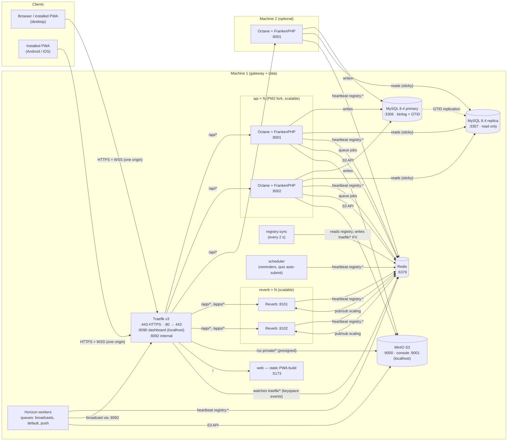
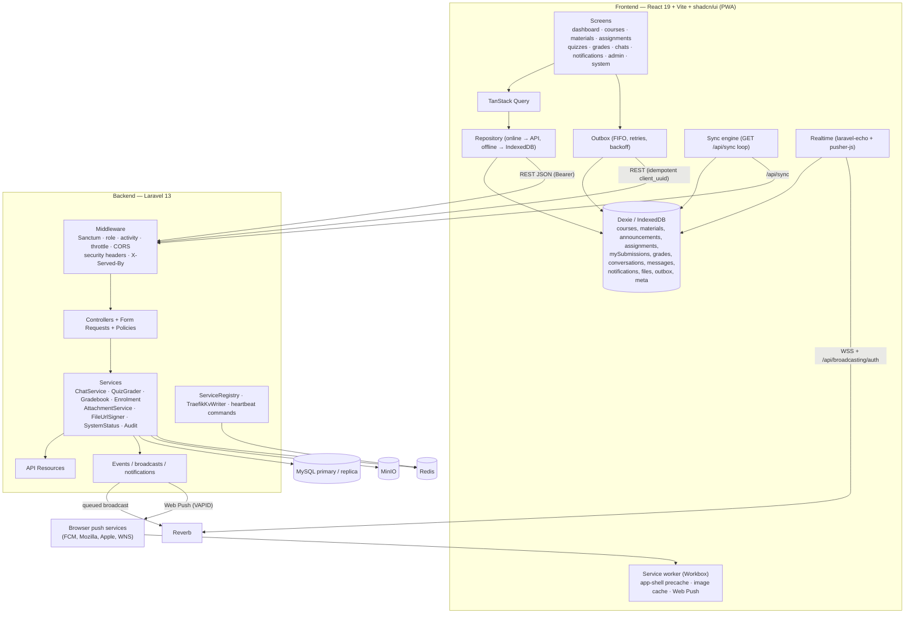
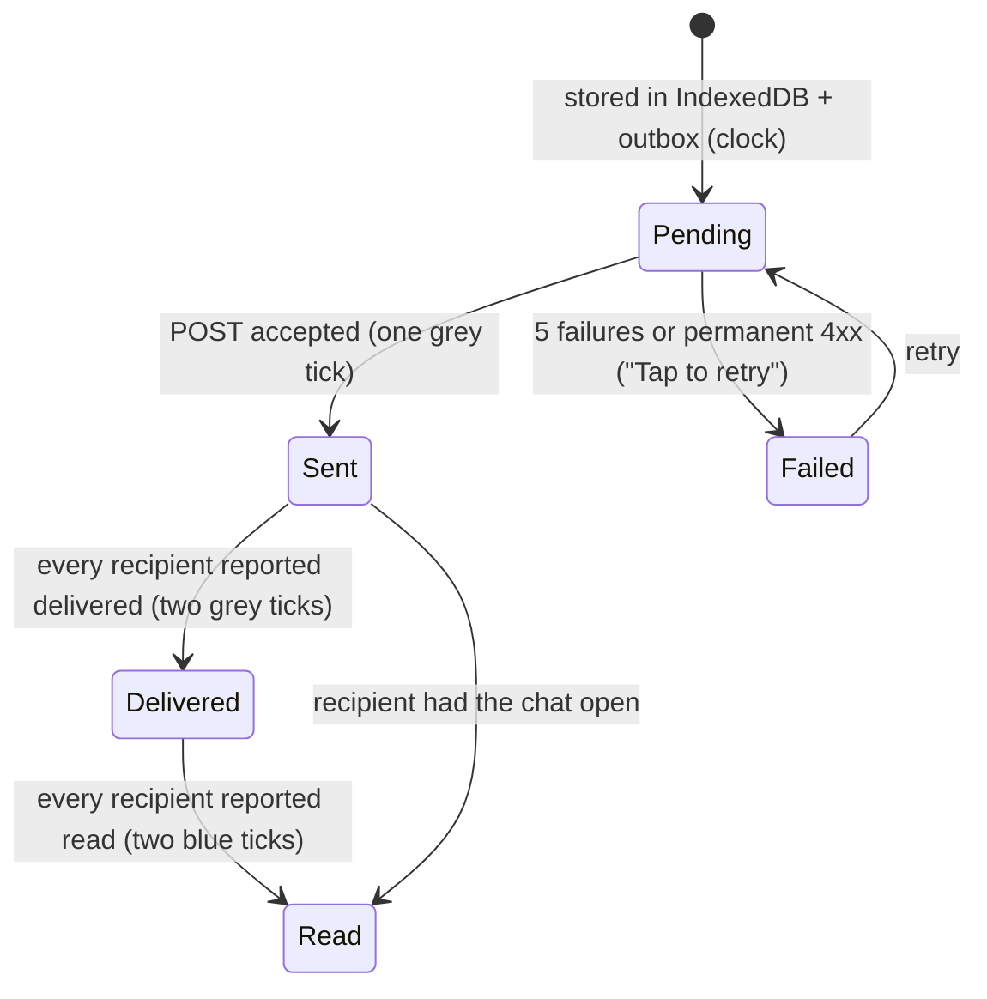
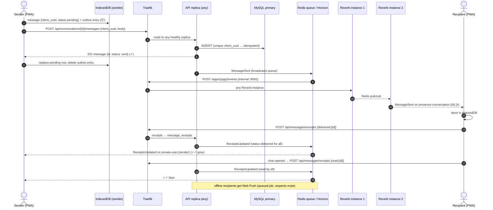
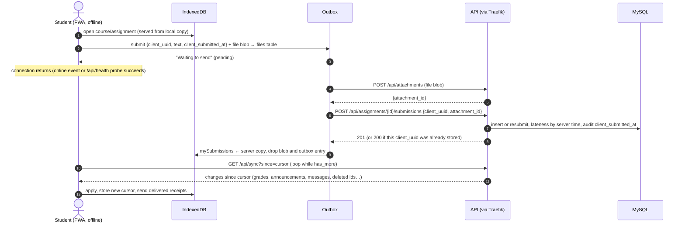
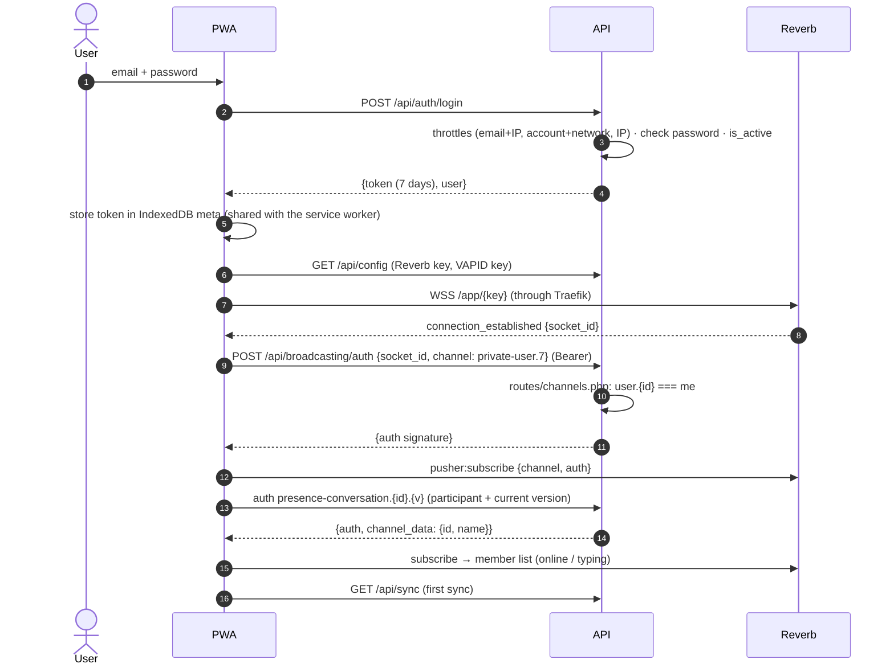
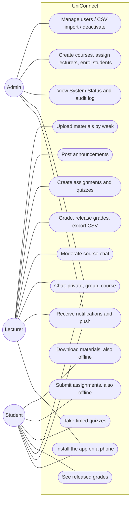

# UniConnect — architecture

UniConnect is a learning platform (courses, materials, assignments, quizzes, gradebook) with
WhatsApp-style messaging, real-time notifications and an offline-capable installable web app (PWA).
It is built as a set of native processes managed by PM2 — no containers — that can be spread over
several machines on the same network.

- [1. Deployment](#1-deployment)
- [2. Components](#2-components)
- [3. Service discovery](#3-service-discovery)
- [4. Database replication](#4-database-replication)
- [5. Real-time messaging and Reverb scaling](#5-real-time-messaging-and-reverb-scaling)
- [6. Offline and sync](#6-offline-and-sync)
- [7. Security architecture](#7-security-architecture)
- [8. Sequences](#8-sequences)
- [9. Data model](#9-data-model)
- [10. Use cases](#10-use-cases)

## 1. Deployment

Every box is a native OS process. PM2 (`ecosystem.config.cjs`) starts and supervises all of them,
including the two MySQL servers (decision D2). Ports are the defaults from `backend/.env.example`;
each can be changed in `backend/.env`.



| Process | PM2 name | Instances | Port | Role |
|---|---|---|---|---|
| Traefik v3 | `traefik` | 1 | 443 / 80 / 8090 / 8092 | gateway, TLS, load balancing, health checks, retry |
| API | `api` | 2 (scalable) | 8001 + instance id | Laravel 13 on Octane + FrankenPHP (4 workers each) |
| Reverb | `reverb` | 2 (scalable) | 8101 + instance id | WebSockets (Pusher protocol), Redis pub/sub scaling |
| Registry sync | `registry` | 1 | — | heartbeats → Traefik Redis KV |
| Horizon | `worker` | 1 (2–4 broadcast processes + 1–3 default/push) | — | broadcasts, notifications, Web Push |
| Scheduler | `scheduler` | 1 | — | `assignments:remind`, `quizzes:close-expired` |
| MinIO | `minio` | 1 | 9000 / 9001 | private object storage (S3 API) |
| Web | `web` | 1 | 5173 | production build of the PWA |
| MySQL primary | `mysql-primary` | 1 | 3306 | writes, binlog, GTID |
| MySQL replica | `mysql-replica` | 1 | 3307 | read-only replica |
| Redis | OS service | 1 | 6379 | cache, queues, pub/sub, registry, Traefik KV |

A second machine only needs PHP and the backend checked out: it runs `pm2 start ecosystem.config.cjs --only api`
with `APP_ADVERTISE_HOST` set to its LAN IP and `REDIS_HOST`, `DB_*` and `AWS_ENDPOINT` pointing at
machine 1. Its instances register in the same Redis and Traefik starts routing to them
(see [deployment.md](deployment.md#multi-machine)).

## 2. Components



Backend modules (in `backend/app`):

| Area | Main classes |
|---|---|
| Auth & users | `AuthController`, `PasswordResetController`, `MeController`, `Admin\UserController`, `UserPolicy`, `Audit` |
| LMS | `CourseController`, `MaterialController`, `AnnouncementController`, `AssignmentController`, `SubmissionController`, `QuizController`, `QuizAttemptController`, `GradebookController`, `Support\Lms\{QuizGrader,Gradebook}`, `Support\Enrolment` |
| Messaging | `ConversationController`, `MessageController`, `ContactController`, `Support\Chat\ChatService`, events `MessageSent`, `MessageDeleted`, `ConversationChanged`, `ReceiptsUpdated` |
| Notifications | `Notifications\*`, `Channels\RealtimeChannel`, `Listeners\Send*Notifications`, `SendDeadlineReminders`, `PushSubscriptionController` |
| Files | `AttachmentController`, `Support\Files\{AttachmentService,FileUrlSigner}`, `AttachmentPolicy` |
| Sync | `SyncController` |
| Distributed | `Support\Registry\*`, `RegistryHeartbeat`, `RegistrySync`, `Support\System\SystemStatus`, `Admin\SystemController`, `AddServedBy` |

## 3. Service discovery

One registry, two consumers (PRD 5.2).

1. **Registration.** Every instance writes `registry:{service}:{host}:{port}` to Redis every 5 s with a
   15 s TTL. The value is `{service, host, port, url, pid, version, hostname, started_at, last_seen, load}`.
   - `api`: a sidecar (`php artisan registry:heartbeat api --port --pid --health`) started by
     `scripts/run-api.sh` next to Octane. It only advertises the instance while `GET /api/health` returns 2xx.
   - `reverb`: registers from inside its own event loop (`ReverbHeartbeat`) and also reports its
     current number of connections.
   - `worker`, `scheduler`: the same sidecar without a URL (`scripts/run-with-heartbeat.sh`).
   - On SIGTERM (PM2 stop) the key is deleted at once; if a process dies, the key expires.
2. **Gateway.** `php artisan registry:sync` (PM2 `registry`, every 2 s) turns the live heartbeats into
   Traefik's Redis-KV layout:
   ```
   traefik/http/services/api/loadBalancer/servers/0/url = http://127.0.0.1:8001
   traefik/http/services/api/loadBalancer/servers/1/url = http://127.0.0.1:8002
   traefik/http/services/api/loadBalancer/healthCheck/path = /api/health   (interval 5s, timeout 3s)
   traefik/http/services/reverb/loadBalancer/servers/…  (health /up)
   ```
   The list is contiguous, only changed keys are written (so Traefik reloads only on membership
   changes), new servers are added before stale indexes are removed, and keyspace notifications are
   switched on because the Redis provider needs them. Routers live in the file provider
   (`infra/traefik/dynamic/routes.yml`) and point at `api@redis` / `reverb@redis`.
3. **Application view.** `GET /api/admin/system` reads the same registry plus Traefik's own
   health-checked view and checks MySQL, the replica, Redis, MinIO, queues and sockets; the System Status
   page polls it every 5 s.

Failover: Traefik's `retry` middleware resends a request whose connection to a backend failed (no
response yet) to another server, which covers the ≤ 3 s between an instance dying and the next sync.
`X-Served-By: host:port` on every response shows which replica answered.

## 4. Database replication

- Primary (`server-id=1`, binlog, GTID) and replica (`server-id=2`, `read_only`, `super_read_only`) are
  set up by `infra/mysql/setup-replication.sh` with `CHANGE REPLICATION SOURCE TO … SOURCE_AUTO_POSITION=1`.
- Laravel's `mysql` connection has a `read` host (replica) and `write` host (primary) with `sticky => true`:
  after a write, the rest of that request reads from the primary (read-your-writes). Everything else reads
  from the replica.
- Lag is shown two ways on the System Status page: the replica's `Seconds_Behind_Source` and a measured
  value (a token written to `replication_probes` on the primary, polled on the replica — typically 20–30 ms
  on one machine). Monitoring uses a separate non-sticky `mysql_replica` connection (D50).

## 5. Real-time messaging and Reverb scaling

- Clients connect to `wss://<host>/app/<key>`; Traefik balances the upgrade to any Reverb instance. A
  WebSocket stays on the instance it reached, so no sticky sessions are needed.
- Reverb runs with `REVERB_SCALING_ENABLED=true`: an event published to any instance goes through Redis
  pub/sub (`uniconnect-reverb` channel) to all instances, so users on different instances chat in real
  time (`make verify-realtime`).
- The API never talks to a specific Reverb: Horizon workers publish through Traefik's internal
  entrypoint (`:8092`), which balances over the discovered instances (D9).
- Broadcasts run on a dedicated `broadcasts` queue with blocking pops; measured REST send → frame on
  another instance ≈ 25 ms (D35).

Channels:

| Channel | Who | Events |
|---|---|---|
| `private-user.{id}` | that user | `NotificationCreated`, `ConversationCreated`, `ConversationUpdated`, `ReceiptsUpdated` |
| `presence-conversation.{id}.{version}` | current participants | `MessageSent`, `MessageDeleted`, whisper `typing` |
| `private-course.{id}` | enrolled users | `AnnouncementPosted`, `MaterialPublished`, `AssignmentPublished`, `QuizPublished` |
| `presence-online` | signed-in users (ids only) | presence for online dots |

The conversation channel name carries a version that changes when a member is removed, so a removed
user's open subscription stops receiving (D39). See [realtime.md](realtime.md) for payloads.

### Delivery status (ticks)



## 6. Offline and sync

The device is a partial replica of the server (DIST-7):

- **Read path:** screens read through a repository. Online it fetches, stores in IndexedDB and returns;
  offline (or when a request fails without a response) it reads IndexedDB and the UI says
  "Offline – showing saved data". Chats always render from IndexedDB.
- **Write path:** messages, assignment submissions (with the file blob) and announcement drafts go to the
  outbox, which is processed FIFO when online: upload the file, then send the record with
  `attachment_id`; retries back off 1 s, 2 s, 4 s … 60 s; after 5 failures (or a permanent 4xx) the entry is
  marked failed. The server is idempotent on `client_uuid`, so a retry never duplicates.
- **Delta sync:** `GET /api/sync?since=<updated_at|id>` returns what changed (courses, materials,
  announcements, assignments, my submissions, released grades, conversations, messages, receipts,
  notifications, deleted ids, memberships). The client loops while `has_more`. Sync runs on start, when the
  connection comes back (browser event or `/api/health` probe), after a Reverb reconnect and every 60 s.
  A 2-second overlap per round covers transactions that commit late; messages are keyset-paginated
  by `(updated_at, id)` (D46).
- **Conflicts:** the server is the source of truth. Messages are append-only (no conflicts). Submissions:
  last write before the deadline wins; lateness uses the server receive time; a graded submission is
  final. Lecturer-edited records (materials, announcements, assignments, quizzes, grade items) carry
  `updated_at`; editing a stale version returns 409 and the client reloads. Deletions are soft and are
  sent in `deleted`.
- **PWA:** the service worker precaches the app shell (the app opens with no network), caches private
  images by path, shows Web Push notifications and focuses/opens the right screen on click.

## 7. Security architecture

| Layer | Controls |
|---|---|
| Transport | HTTPS only (mkcert), HSTS, HTTP→HTTPS redirect at Traefik |
| Identity | Sanctum bearer tokens (7 days), login throttling per email+IP / account+network / IP, deactivation revokes tokens |
| Authorization | Policies for every model; course enrolment, lecturer role per course, chat participation; broadcast channel auth |
| Data | Message bodies encrypted at rest; private bucket; 5-minute presigned URLs signed for the request host; Authorization header stripped on the file route |
| Input | Form Requests / validation, MIME + extension allow-list (libmagic), 20 MB, random names, SHA-256 |
| Browser | CSP (`script-src 'self'`), nosniff, frame options, referrer policy, React text rendering |
| Abuse | Rate limits: login, API 120/min, messages 60/min, uploads 20/min |
| Accountability | Audit log for security-relevant actions + admin UI |
| Operations | Admin consoles bound to localhost, Horizon host-only, debug off |

Details: [testing/security-checklist.md](testing/security-checklist.md).

## 8. Sequences

### 8.1 Send a message (sent → delivered → read)



### 8.2 Offline submission → reconnect → sync



### 8.3 Login and channel authorization



## 9. Data model

```mermaid
erDiagram
  users ||--o{ course_user : enrolled
  courses ||--o{ course_user : has
  courses ||--o{ course_materials : has
  courses ||--o{ announcements : has
  courses ||--o{ assignments : has
  courses ||--o{ quizzes : has
  courses ||--o{ grade_items : has
  courses ||--|| conversations : "course chat"
  assignments ||--o{ submissions : receives
  users ||--o{ submissions : submits
  quizzes ||--o{ quiz_questions : contains
  quiz_questions ||--o{ quiz_options : offers
  quizzes ||--o{ quiz_attempts : taken
  quiz_attempts ||--o{ quiz_answers : records
  grade_items ||--o{ grades : holds
  users ||--o{ grades : earns
  conversations ||--o{ conversation_participants : has
  users ||--o{ conversation_participants : joins
  conversations ||--o{ messages : contains
  messages ||--o{ message_receipts : tracked_by
  messages |o--o| messages : "reply_to"
  attachments |o--o{ course_materials : file
  attachments |o--o{ assignments : file
  attachments |o--o{ submissions : file
  attachments |o--o{ messages : file
  users ||--o{ attachments : owns
  users ||--o{ notifications : receives
  users ||--o{ push_subscriptions : registers
  users ||--o{ audit_logs : performs

  users {
    bigint id PK
    string email UK
    string role "admin|lecturer|student"
    bool is_active
    timestamp last_seen_at
    json notification_preferences
  }
  courses {
    bigint id PK
    string code UK
    string title
    string semester
    timestamp deleted_at
  }
  course_user {
    bigint course_id FK
    bigint user_id FK
    string role "lecturer|student"
  }
  course_materials {
    bigint id PK
    bigint course_id FK
    smallint week
    bigint attachment_id FK
    timestamp published_at
    timestamp deleted_at
  }
  announcements {
    bigint id PK
    bigint course_id FK
    string client_uuid UK
    text body
    timestamp published_at
  }
  assignments {
    bigint id PK
    bigint course_id FK
    timestamp due_at
    decimal max_score
    bool allow_late
    tinyint late_penalty_percent
  }
  submissions {
    bigint id PK
    bigint assignment_id FK
    bigint student_id FK
    string client_uuid UK
    bool is_late
    decimal score
    timestamp graded_at
  }
  quizzes {
    bigint id PK
    bigint course_id FK
    timestamp opens_at
    timestamp closes_at
    smallint time_limit_minutes
    tinyint max_attempts
  }
  quiz_attempts {
    bigint id PK
    bigint quiz_id FK
    bigint student_id FK
    timestamp deadline_at
    timestamp submitted_at
    decimal score
    bool needs_manual_grading
  }
  grade_items {
    bigint id PK
    bigint course_id FK
    string source_type "assignment|quiz|manual"
    decimal weight_percent
    timestamp released_at
  }
  grades {
    bigint id PK
    bigint grade_item_id FK
    bigint student_id FK
    decimal score
  }
  conversations {
    bigint id PK
    string type "direct|group|course"
    string direct_key UK
    bigint course_id FK
    bool announcements_only
    int channel_version
  }
  conversation_participants {
    bigint conversation_id FK
    bigint user_id FK
    string role
    bigint last_read_message_id
    timestamp muted_until
  }
  messages {
    bigint id PK
    bigint conversation_id FK
    string client_uuid UK
    text body "encrypted"
    bigint reply_to_id FK
    timestamp deleted_at
  }
  message_receipts {
    bigint message_id FK
    bigint user_id FK
    timestamp delivered_at
    timestamp read_at
  }
  attachments {
    bigint id PK
    bigint owner_id FK
    string path UK
    string mime
    bigint size_bytes
    char sha256
  }
  audit_logs {
    bigint id PK
    bigint user_id FK
    string action
    string subject_type
    json meta
    string ip
  }
```



All tables have `id`, `created_at`, `updated_at`; synced tables also have `deleted_at` and an index on
`updated_at`. Every foreign key is indexed. Full definitions: `backend/database/migrations/`.

## 10. Use cases


